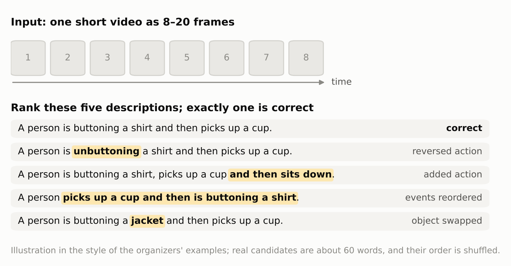
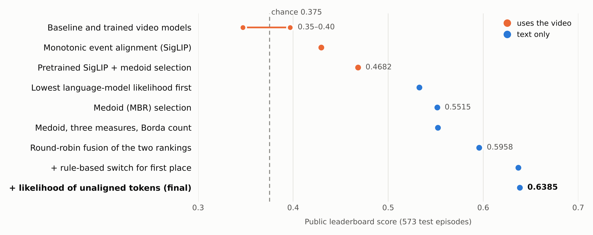

# Fine-grained multimodal video ranking

Team 07's entry to the **InThon 2026 Datathon** (final submission November 1, 2026). Given the frames of a short
video and five candidate descriptions that differ in a single detail, rank the descriptions from most to
least likely.

**Result:** **0.6408 on all 1,910 test episodes** (chance 0.375) with a text-only ranking rule: 0.6385 on
the public 30% and 0.6417 on the private 70%. The organizers reported the combined score; the private
score follows from it and the public one.
The more useful result is *why* it is text-only: every video model we built reached about 0.8 on our own
validation and fell to chance on the test set. The sections below explain what went wrong and what worked
instead.

## The task

| | |
|---|---|
| Input per episode | 8–20 RGB frames and 5 candidate descriptions (about 60 words each) |
| Output | The 5 candidates in ranked order |
| Score per episode | 1, 0.5, 0.25, 0.125, 0 for the correct description at rank 1–5; the leaderboard is the mean |
| Training data | 4,170 episodes from the PerceptionTest video benchmark, **one correct description each, no wrong ones** |
| Test data | 1,910 episodes from a **different benchmark** (30% public, 70% private), 1 correct + 4 wrong candidates |
| Constraints | Only four permitted pretrained models (DINOv2-base, all-mpnet-base-v2, SigLIP-base, SmolVLM-256M); inference for all 1,910 episodes in 15 minutes on one T4, offline; submission ZIP ≤ 1 GB; no distillation from other models; final model built on Colab |

The organizers' examples show what makes it hard. The wrong candidates describe the *same* scene as the
correct one and change one thing: a reversed action ("buttoning" vs "unbuttoning") or an added action
("... and then sits down"). Telling them apart needs the order of events in the video, not just its content.

<picture>
  <source media="(prefers-color-scheme: dark)" srcset="docs/figures/task_dark.png">
  
</picture>

## What we learned

1. **Local validation measured the wrong skill.** With no wrong descriptions in the training data, we made
   our own: mostly other videos' descriptions. A model passes those by matching objects in the scene. That
   skill is useless when all five candidates describe the same scene, so models at about 0.8 locally scored
   0.35–0.40 on the public set.
2. **Sentence embeddings hide one-word differences.** A one-word edit of a 60-word description keeps its
   MPNet embedding at cosine similarity 0.983 on average. Any model that compares one sentence vector with
   the video cannot see the edit.
3. **Every image signal that changed the text ranking lost.** Trained video rankers, SigLIP ensembles and
   a fine-tuned SmolVLM all scored at or below the text-only rules. The one image method with a real
   order signal, a training-free **monotonic alignment** of a candidate's events to the frames (SigLIP
   per event, dynamic programming over frames, as in dynamic time warping), scored 0.4295 alone, above
   chance, but added nothing when combined.
4. **The test candidates contain annotation artifacts.** Text-only rules, which never see the video, beat
   chance by a wide margin: a **hypothesis-only baseline** in the sense of Gururangan et al. (2018) and
   Poliak et al. (2018). Two such scores worked, and they were uncorrelated per episode:
   - **Medoid / minimum Bayes risk (MBR) selection** (our *centrality*): the candidate most similar to the
     other four comes first. If the wrong candidates are edits of the correct one, the correct one is
     the consensus of the set.
   - **Lowest n-gram language-model likelihood first** (our *reversed familiarity*): the candidate whose
     wording is *least* likely under a word-bigram model fitted on the training descriptions comes
     first. Ranking the most likely first scored 0.2411, far below chance, so the direction itself is a
     measured fact; its cause is not known.

   **Round-robin rank fusion** of the two rankings, with a **rule-based switch** that decides which goes
   first, gave the final rule.
5. **Worst-case bounds before uploads.** With 30 leaderboard checks, we computed the worst case of a rank
   fusion exactly, by enumerating every placement of the unseen wrong candidates in the per-episode
   public results (`team/evaluation/merge_bounds.py`): round-robin fusion could not score below 0.5639,
   and it scored 0.5958.

Our own names for these methods, as used in the code and the competition-day notes, are mapped to the
standard names in [docs/glossary.md](docs/glossary.md).

## How the score improved

<picture>
  <source media="(prefers-color-scheme: dark)" srcset="docs/figures/scores_dark.png">
  
</picture>

| Submission (public leaderboard) | Uses the video | Public |
|---|---|---:|
| Organizers' baseline, trained video rankers, SigLIP ensemble | Yes | 0.347–0.397 |
| Pretrained SigLIP + medoid selection | Yes | 0.4682 |
| Monotonic event-to-frame alignment alone (SigLIP) | Yes | 0.4295 |
| Lowest language-model likelihood first, alone | No | 0.5327 |
| Medoid (MBR) selection alone | No | 0.5515 |
| Medoid selection, three similarity measures fused by rank sum (Borda count) | No | 0.5521 |
| Round-robin fusion: Borda-count medoid and lowest likelihood | No | 0.5958 |
| + rule-based switch: lowest likelihood first when no candidate looks like the source of the edits | No | 0.6368 |
| + likelihood of the unaligned tokens only, when the switch fires (**final**) | No | **0.6385** |

One public score is uncertain by about ±0.016, so the last step (+0.0017) is within noise; it became the
final because it was the highest score. On the private 70% the final scored 0.6417, slightly above its
public score, so the rule did not overfit the public leaderboard. Every number, with its settings and the validation data behind
it, is in [docs/experiments/validation.md](docs/experiments/validation.md).

## Final method

For each episode, from the five candidate texts alone:

1. **Medoid (MBR) selection, Borda-count fusion** (our `text_blend`): rank each candidate by its
   similarity to the other four, as the sum of three ranks: token overlap with the other candidates,
   mean MPNet cosine similarity, and Ratcliff/Obershelp word-sequence similarity.
2. **Lowest language-model likelihood first** (our *reversed familiarity*): rank by the mean
   log-probability of each candidate's word pairs under an interpolated bigram model fitted on the
   training descriptions, least likely first. When the switch below fires, only the word pairs that
   touch the candidate's **unaligned tokens** (its edit span: words that match nothing in the other
   candidates under a word-level alignment) are scored.
3. **Rule-based switch** (our *gate*): if some candidate has all its words in the others, it looks like
   the source sentence the others were edited from, and the medoid ranking's pick goes first. Otherwise
   the likelihood ranking's pick goes first.
4. **Round-robin rank fusion** (our *interleave*): fill the ranking by taking the next unused candidate
   from each ranking in turn.

It runs in about 0.02 s per episode. Code: `team/inference/submission_text_rules.py` and `team/evaluation/text_rules.py`.

## Repository layout

```text
.
├── *.py, config.json      organizers' starter kit: baseline model, training, export, packaging, submission entry point
├── tests/                 the kit's tests
├── team/                  our code, run from the root as python -m team.<folder>.<module>; index in team/README.md
│   ├── candidates/        generated negatives and validation candidate sets
│   ├── training/          trained rankers, SmolVLM fine-tuning, the learned event alignment
│   ├── inference/         ranking rules that go into a submission ZIP (the final: submission_text_rules.py)
│   ├── export/            build submission folders and the Colab notebooks
│   ├── evaluation/        local checks and leaderboard analysis
│   ├── siglip_ensemble/   SigLIP training and the three-seed ensemble
│   └── tests/             tests for our code
├── notebooks/             Colab notebooks: the organizers' and our two final-build notebooks
├── docs/
│   ├── starterkit/        the kit's docs in English, Korean originals in ko/
│   ├── competition/       the rules we worked under and their changes
│   ├── experiments/       every experiment, the findings and the end-of-competition audit
│   ├── competition-day/   handoff notes and the presentation outline
│   ├── figures/           the README figures and the script that draws them
│   └── glossary.md        our method names and their standard names
└── cuda/                  local GPU setup; data, models and outputs stay out of git
```

The kit's modules stay at the root because the submission ZIP needs `submission.py` at its top level and our
code imports the kit's `common.py` and `dataset.py`.

| Start here | For |
|---|---|
| [team/README.md](team/README.md) | What each of our scripts does |
| [docs/glossary.md](docs/glossary.md) | Our method names (used in the code and notes) and their standard names |
| [docs/experiments/validation.md](docs/experiments/validation.md) | Every experiment: settings, validation data, local and public scores |
| [docs/experiments/audit.md](docs/experiments/audit.md) | The end-of-competition review: each claim graded as fact, strong, weak or retracted |
| [docs/competition/brief.md](docs/competition/brief.md) | The competition rules we worked under |
| [docs/starterkit/README.md](docs/starterkit/README.md) | The organizers' baseline and how a submission is built |

## Reproducing the final submission

The competition data is the organizers' and is not included. With it in Google Drive at
`MyDrive/data/Train.zip`:

1. Open `notebooks/final_text_colab.ipynb` in Colab (T4 runtime).
2. In section 2, set `METHOD = "blend_interleave_gated_own"` (the final rule), then run all cells. The notebook
   downloads the permitted models, builds the submission ZIP (about 349 MiB) and records the run.

Locally, on an NVIDIA GPU: set up the evaluation environment from [cuda/README.md](cuda/README.md)
(`cuda/requirements-eval.txt`, the package versions the organizers' server used), then run the export
scripts in `team/` (see [team/README.md](team/README.md)). The root `requirements.txt` is the kit's
original list (Python 3.11, torch 2.5.1) and lacks packages our code needs, such as scikit-learn.

## Team

- Naufal Kamaruddin ([@naufalkmd](https://github.com/naufalkmd)): team lead; starter-kit translation, the
  submission rules (round-robin fusion, the rule-based switch and its variants), the final Colab build
- 노준우 ([@njunu17](https://github.com/njunu17)): the first text rules (medoid selection, language-model
  likelihood), SmolVLM experiments, the monotonic event alignment, the worst-case bounds, the audit and
  the validation log
- 한경훈 ([@opolo17](https://github.com/opolo17)): SigLIP training and the three-seed SigLIP ensemble
  (`team/siglip_ensemble/`)
- 민수홍 ([@m2nx6](https://github.com/m2nx6)): SigLIP hybrid ranker (`team/inference/exp6_submission.py`)

The baseline code at the repository root is the organizers' starter kit; commit `a9a4179` is the kit as we
received it.

## References

- S. Gururangan et al. Annotation Artifacts in Natural Language Inference Data. NAACL 2018.
  [arXiv:1803.02324](https://arxiv.org/abs/1803.02324)
- A. Poliak et al. Hypothesis Only Baselines in Natural Language Inference. *SEM 2018.
  [arXiv:1805.01042](https://arxiv.org/abs/1805.01042)
- S. Kumar and W. Byrne. Minimum Bayes-Risk Decoding for Statistical Machine Translation. NAACL 2004.
  [ACL Anthology N04-1022](https://aclanthology.org/N04-1022/)
